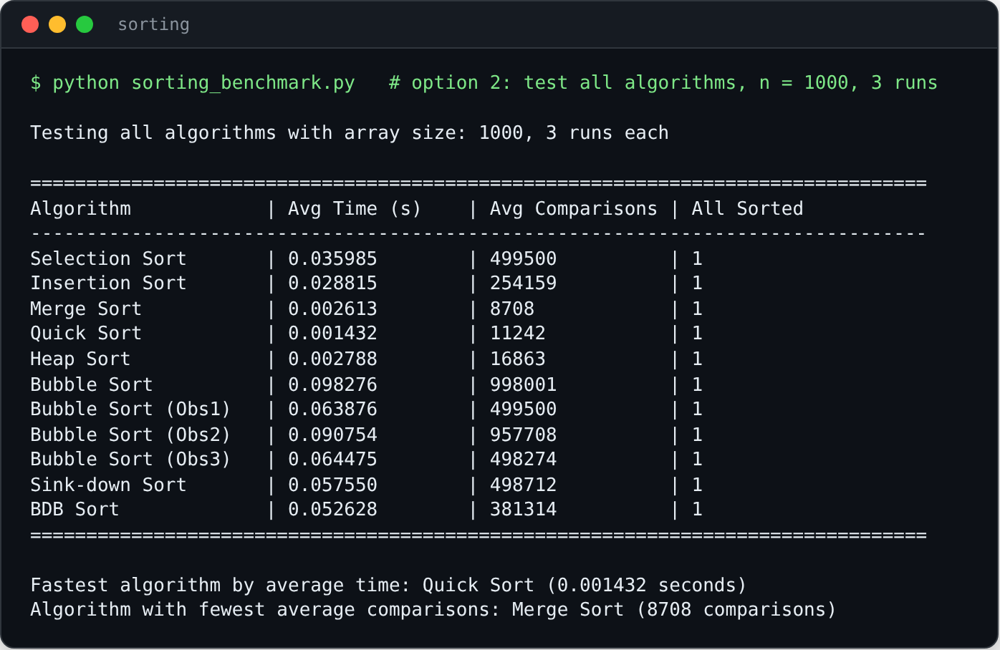
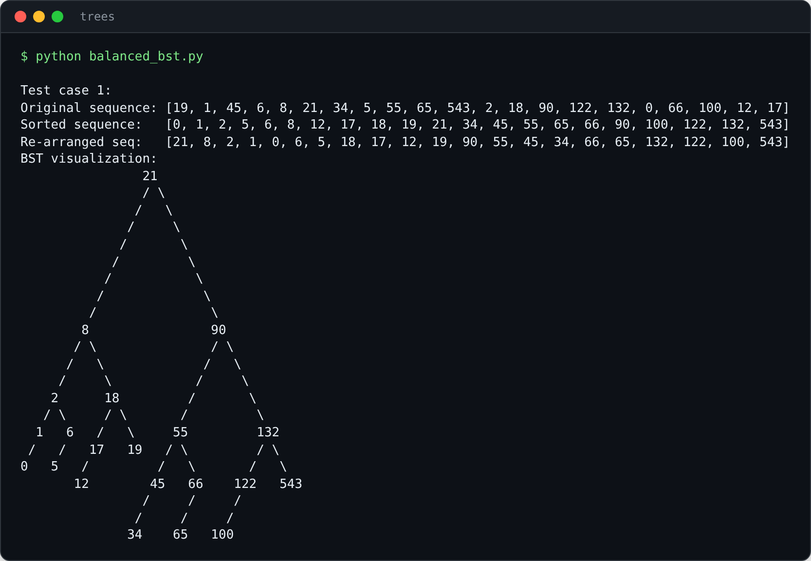

# Data Structures & Algorithms

Two data structures assignments in one repo: a benchmark that pits 11 sorting algorithms against each other, and command-line tools for building, drawing and editing binary search trees and AVL trees.



## What I built
- **Sorting (`sorting/`):** 11 algorithms, from bubble sort and its optimised, sink-down and bidirectional variants to selection, insertion, merge, quick and heap sort. Each one counts its own comparisons and times itself, and a menu benchmarks one or all of them on random arrays.
- **BSTs (`trees/`):** turn any sequence into a balanced or complete BST and draw it in ASCII, plus a menu-driven BST tool for traversals, leaf and non-leaf nodes, subtree and depth queries, insert, delete and conversion to balanced or complete form.
- **AVL tree (`trees/avl_tree.py`):** self-balancing insert and delete with left and right rotations, traversals, and a table of node counts by depth.



## Tools & tech
Python 3, standard library only.

## What I learnt
- How comparison counts show Big-O in practice: around 500,000 comparisons for the O(n²) sorts on 1,000 items, against under 9,000 for merge sort.
- Recursively building balanced and complete BSTs from a sorted sequence.
- Self-balancing rotations and height and balance-factor tracking in an AVL tree.
- Recursive traversals and queries over tree structures.

## Run it
```
cd sorting && python sorting_benchmark.py
```
```
cd trees && python avl_tree.py     # also: bst_tool.py, balanced_bst.py, complete_bst.py
```

Some helper code, such as the ASCII tree printer and the base AVL class, was adapted from reference material rather than written from scratch.

Built for CSP2348 Data Structures at Edith Cowan University, 2025.
